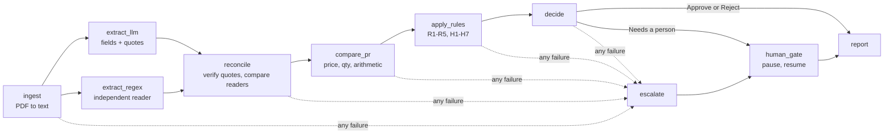

# docgate: Supplier Document Checker

docgate reads supplier quotation PDFs, compares each one with a purchase request and the company's rules, and gives one answer per pack: **Approve**, **Reject** or **Needs a person to check**, with the exact quoted evidence. It is a fixed LangGraph pipeline, not a free-running agent. An LLM only *reads* (extracts fields with verbatim quotes); plain Python does every comparison and makes every verdict, and anything it cannot verify becomes a question for a person instead of a guess.

Built for BIAI Round 2, Task 1. On the 10 sample packs it gets **10/10 correct with 0 unsafe errors** (an unsafe error is an Approve where the answer should not be Approve).


## Quick start (no API key, no Node)

You need **Python 3.12 or newer** and `git`. The demo uses recorded model responses, so it needs no key and no network after install.

**Windows (PowerShell)**

```powershell
git clone https://github.com/sabkatdesh/Docfile.git docgate; cd docgate
py -3.12 -m venv .venv; .venv\Scripts\python tasks.py setup
python tasks.py demo
```

**macOS / Linux**

```bash
git clone https://github.com/sabkatdesh/Docfile.git docgate && cd docgate
python3.12 -m venv .venv && .venv/bin/python tasks.py setup
python tasks.py demo
```

That is: clone, create the environment and install, run. `demo` checks all 10 packs and ends with `10 packs: 2 Approve, 3 Needs a person to check, 5 Reject`.

Then open the app:

```bash
python tasks.py serve
```

and go to <http://127.0.0.1:8000>. Press **Run all checks**, open a pack, and use **Review queue** for the three packs that wait for a person.

You do not need to activate the environment: `tasks.py` hands over to `.venv` by itself. `web/dist` (the built front end) is committed, so Node is not needed to run the app. Prove the score:

```bash
python tasks.py eval
```

## Live mode (Groq)

Replay uses recorded responses. To call a real model:

1. Copy `.env.example` to `.env` and set `GROQ_API_KEY=` (free key from console.groq.com). `.env` is git-ignored.
2. `python tasks.py live` (same as `run --provider groq`).

`demo`, `eval`, `run` and `serve` stay on replay unless you pass `--provider groq`, whatever `.env` says. `python tasks.py record` is what re-records the responses. The default model is `openai/gpt-oss-120b`. The free tier is slow (calls are spaced 25 s apart, a few thousand tokens per minute), so a live run of all 10 packs takes several minutes.

## How it works



Source: `src/docgate/workflow/graph.py`. The edges are fixed in code; there is no tool-calling loop.

### The LLM reads, code judges

The model's only job is to return each field as text exactly as printed, with a verbatim quote. It never converts units, does arithmetic, applies a rule or touches a verdict. Everything after extraction is deterministic Python: money is `Decimal`, thresholds live in one config object (`src/docgate/domain/config.py`), each rule is a small pure function, and the verdict follows a fixed precedence: any Reject-rule failure gives Reject; otherwise any Needs-person failure or unknown gives Needs a person; otherwise Approve. The plain-English reason is produced from a template over the structured findings, not by the model.

### How it never guesses

- **Quote verification.** A value is kept only if its quote is found in the PDF text. No verified quote, no value.
- **Dual extraction.** The LLM and an independent regex reader must agree. Disagreement is a `CONFLICT`; one unreadable is `UNVERIFIED`; both absent is `MISSING`.
- **`UNKNOWN` is its own state.** A rule that cannot be decided is UNKNOWN, and UNKNOWN never counts as a pass. Approve needs all 12 rules to pass.
- **Failures escalate.** Malformed model output is retried once, network errors are retried with back-off (up to 4 attempts), and then the pack becomes "Needs a person". A node crash escalates the same way. Nothing crashes into an Approve.
- **A real human pause.** "Needs a person" packs stop at a LangGraph `interrupt()` backed by SQLite. The person's decision and reason are recorded next to the machine verdict, never over it, and survive a restart. The gate offers Approve or Reject, with a mandatory reason.

## Results on the 10 sample packs

From `python tasks.py eval`:

| Pack | Expected | Actual | Deciding fact |
|---|---|---|---|
| 01 | Approve | Approve | all 12 checks pass |
| 02 | Approve | Approve | all 12 checks pass |
| 03 | Reject | Reject | R1: price 229 vs max 210 (+9.05%) |
| 04 | Needs a person | Needs a person | H1: price +2.31% over max |
| 05 | Reject | Reject | R2: 40% advance |
| 06 | Reject | Reject | R3: no late-delivery penalty |
| 07 | Needs a person | Needs a person | H2: quantity 16,500 vs 20,000 (-17.5%) |
| 08 | Reject | Reject | R4: TIN and BIN missing |
| 09 | Needs a person | Needs a person | H6: 50,000 x 6.40 = 320,000 but quoted 322,000; H3: payment "30 to 90 days" |
| 10 | Reject | Reject | R5: delivery in 60 days |

Accuracy 10/10, unsafe errors 0, conservative misses 0. Eval scores the machine decision, so a person's later decision can never hide a wrong verdict. Ten samples are a sanity check, not proof the system generalises; the mutation suite below is the better evidence.

## Tests

```bash
python tasks.py check            # ruff, ruff format, mypy --strict, pytest
python tasks.py eval             # golden set: score table, unsafe errors
python tasks.py mutation-report  # regenerate data/golden/mutation_results.json
python tasks.py web-check        # front end: lint, types, tests (needs Node 20+)
python scripts/fresh_clone.py    # clone HEAD, install, demo offline, check (slow)
```

`check` runs 811 Python tests (rule boundaries, golden packs, mutation, failure and API suites). The front end has 145 tests across 14 files, including one end-to-end smoke test. The mutation suite has 39 cases through the real pipeline: change one value in a passing pack and the verdict must flip (price +3.1%, advance 21%, TIN removed, delivery 46 days, quantity -6%, and more), boundary "twins" that must stay safe (exactly 3.00%, 20%, 30 days), "stale" cases where the text no longer matches the recording and must be refused, and whitespace noise that must not change anything.

## Project layout

```
src/docgate/
  domain/       models, Decimal money helpers, thresholds (imports nothing)
  ingest/       PDF to text, purchase-request CSV, whitespace normalising
  extraction/   LLM extractor, regex extractor, quote verification, reconcile, prompts/
  llm/          provider protocol, Groq, replay provider, retry
  compare/      price and quantity deltas, arithmetic checks
  rules/        R1-R5 reject rules, H1-H7 review rules, decision precedence
  workflow/     LangGraph state, nodes, graph, runner, run log
  review/       human gate: checkpoint store, pending items, resolve
  reporting/    JSON and Markdown reports, templated explanations
  evaluation/   golden scoring, mutation suite
  api/          FastAPI + SSE (thin shell over workflow)
  cli.py        command line (thin shell)
web/            React + TypeScript front end (web/dist is the committed build)
data/sample/    the 10 PDFs, purchase request, company rules
data/recorded/  recorded model responses for replay
data/golden/    expected verdicts and mutation results
tests/          unit, golden, mutation, failure, api
docs/           NOTE.md, DECISIONS.md, LOOM_SCRIPT.md, openapi.json
```

`rules` depends only on `domain` and `compare`; `api` and `cli` hold no business logic. Judgment calls are logged in [docs/DECISIONS.md](docs/DECISIONS.md).

## Limitations

- The regex cross-check is written for this quotation template. A different layout would make it unreadable, so most fields would become UNVERIFIED and go to a person (safe, but unhelpful).
- Text PDFs only. Scanned PDFs fail loudly; there is no OCR.
- Only 10 samples. 10/10 shows the pipeline works on them; it does not show it generalises.
- Each pack is assumed to hold one item from the purchase request. A price in a different unit, or a VAT-inclusive price (pack 10), cannot be compared and becomes UNKNOWN.
- Replay uses recordings from one model (`openai/gpt-oss-120b`) and one prompt version (`extract-v3`). Change either, or edit a PDF, and replay has no recording for it; that case is refused, not guessed.
- Live mode depends on Groq's free tier (rate limits, daily token cap) and is slow.
- One active database and one run at a time; no login and no multi-user handling. The server binds to localhost only.
- The human gate offers Approve or Reject only (no "request more information").
- `sqlite-vec` is installed as a hard dependency of the LangGraph SQLite checkpointer but unused by this code. It is pinned to 0.1.9; its binary was not independently matched to the upstream release.
- The front end is tested in jsdom, not a real-browser test suite. The original PDF opens in a new tab; there is no in-page PDF rendering.
- Dependencies are pinned but not hash-locked. Python 3.12+ is required.

## How I used AI

I used Claude Code (Anthropic's coding agent) as the main builder, and I want to be plain about that: it wrote most of the code and tests in this repository. My part was the design and the control:

- **Spec first.** Before any code I wrote a design spec and the golden answers for the 10 packs (`expected.json`), and a milestone plan (M0 to M7) with working rules for the agent.
- **One milestone at a time, with plan approval.** For the milestones with real design choices the agent proposed a plan and I approved or changed it before it wrote code. Each milestone ended with a commit and a stop; I did not let milestones stack up unreviewed.
- **Tests before logic** for the rules and the arithmetic. Boundary tests (3.00% vs 3.01%, 30 vs 31 days, and so on) came first and the code was written to pass them.
- **Decisions that are mine.** The principle that the LLM reads and code judges; Reject outranks Needs a person; "more than" means strictly greater; unknown never resolves to pass; a run starts from a fresh database by default, but the API answers 409 and names the packs instead of silently discarding a person's pending decision; Groq instead of Bedrock; committing the built front end so the demo needs no Node.
- **Verification.** I read the diffs and ran `check` and `eval` myself. I did not edit the golden answers to get a pass. The decision log records process slips honestly (for example, one milestone tag created retroactively, and M5.5 code found uncommitted before the session that audited it).

<!-- PLACEHOLDER (author to fill in or delete): total hours spent, and any AI tool used besides Claude Code. -->

## Troubleshooting

- **"requires-python >=3.12" or syntax errors on install.** Your default `python` is too old. Create the environment with a specific version: `py -3.12 -m venv .venv` (Windows) or `python3.12 -m venv .venv`. Delete a half-made `.venv` first.
- **`python tasks.py demo` says packages are missing.** `setup` has not run in `.venv`. Run `.venv\Scripts\python tasks.py setup` (Windows) or `.venv/bin/python tasks.py setup`.
- **Port already in use.** `python tasks.py serve --port 8001`.
- **The browser shows a placeholder page.** `web/dist` is missing. Run `python tasks.py web-install` and `python tasks.py web-build` (needs Node 20+).
- **409 "pending reviews would be lost" when running.** Packs are waiting for a decision from an earlier run. Resolve them in **Review queue**, or confirm the discard in the dialog.
- **Live mode says `GROQ_API_KEY is not set`.** Put the key in `.env` (copied from `.env.example`). `demo`, `eval` and `serve` never need it.
- **Stale results.** Reports and databases live in `runs/` (git-ignored). Delete the folder to start clean.

## License

MIT, see [LICENSE](LICENSE).
